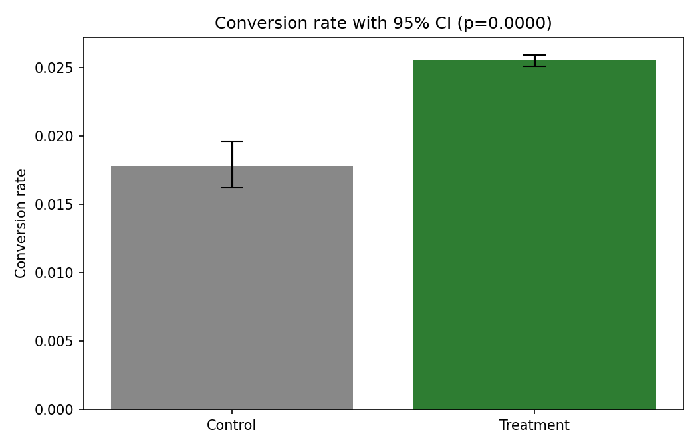

# 🛒 E-Commerce Market Intelligence & Promotion Experimentation

Two connected halves: **live marketplace data collection** via the eBay
Browse API, and a **rigorous A/B test analysis pipeline** (power analysis,
sample-ratio checks, multiple-comparison correction, CUPED), run on both a
simulated experiment with a known answer and a real public dataset.



## Problem Statement

**Part A** asks what real marketplace listings reveal about pricing: does free
shipping carry a premium, how big is the new-versus-used gap, do title
keywords command higher prices, and does seller reputation correlate with
price?

**Part B** asks a different question: given an experiment's raw metrics, can
we draw a trustworthy causal conclusion, and can we tell when we can't?

## Data

**Part A:** 1,976 live eBay listings (1,975 after filtering prices outside
$1 - $5,000), collected via the Browse API across five categories: wireless
earbuds, mechanical keyboards, running shoes, smart watches, and DSLR cameras.

**Part B** uses two sources side by side:
- **Simulated:** generated with a known 12% relative lift in conversion, to
  check that the pipeline detects (or correctly fails to detect) a real
  effect.
- **Real:** Kaggle's [Marketing A/B Testing](https://www.kaggle.com/datasets/faviovaz/marketing-ab-testing)
  dataset (ad vs. public-service-announcement exposure).

Raw data is not committed.

## Approach

**Part A:** `src/collect.py` authenticates with OAuth client credentials,
paginates the Browse API, backs off on 429 rate limits, and caches responses
locally. `src/market_analysis.py` runs a free-shipping premium test
(Welch's t), a new-vs-used test (Mann-Whitney U, since prices are skewed),
within-category title-keyword comparisons, and a seller-feedback correlation
(Spearman).

**Part B** (`src/ab_test.py`, `src/experiment.py`), in the order a real
experiment demands:
1. **Power analysis** before looking at results
2. **Sample ratio mismatch (SRM) check** (chi-square on group sizes); if it
   fires, the pipeline says to stop
3. **Hypothesis tests:** two-proportion z-test and Welch's t-test, with
   confidence intervals and effect sizes
4. **Benjamini-Hochberg correction** across metrics
5. **CUPED** variance reduction using a pre-experiment covariate

## Results

### Part A: Market intelligence

**Free-shipping premium** (Welch's t, per category)

| Category | n free | n paid | Median (free) | Median (paid) | Difference | p-value |
|---|---|---|---|---|---|---|
| DSLR camera | 280 | 117 | $139.99 | $174.45 | -19.8% | 0.895 |
| Mechanical keyboard | 368 | 30 | $43.99 | $35.04 | +25.5% | 0.475 |
| Running shoes | 323 | 75 | $49.95 | $63.99 | -21.9% | **0.040** |

Only running shoes reached significance. Smart watches and earbuds had too few
listings in one group to test. The other two categories had few paid-shipping
listings (30 and 117), so those are underpowered comparisons, not evidence of
no effect.

**New vs. used** (Mann-Whitney U)

| Category | Median new | Median used | New vs. used | p-value |
|---|---|---|---|---|
| DSLR camera | $81.99 | $164.05 | -50.0% | <0.001 |
| Mechanical keyboard | $37.64 | $49.95 | -24.6% | <0.001 |
| Running shoes | $52.20 | $50.00 | +4.4% | 0.316 |
| Smart watch | $29.99 | $79.99 | -62.5% | <0.001 |
| Wireless earbuds | $17.00 | $44.99 | -62.2% | <0.001 |

"New" items are cheaper than "used" in four of five categories. The likely
explanation is listing composition, not condition: new listings skew toward
cheap generic accessories while used listings skew toward branded items.
This is correlational.

**Title keywords:** only `sealed` had enough listings on both sides (35) to
test: a +178% median price lift, p = 0.008. Other candidate keywords did not
reach 30 listings per side and were not tested.

**Seller feedback vs. price:** Spearman r = 0.28 (p < 10⁻³⁶). Statistically
solid because of the sample size, but a small effect in practice.

### Part B: A/B test analysis

**Run 1: simulated data (true lift: 12%)**

Baseline conversion 4.07%, with 19,853 control and 20,147 treatment users.

| Metric | Observed lift | p-value | Verdict |
|---|---|---|---|
| Conversion rate | +4.4% | 0.371 | Not significant |
| Revenue per user | +9.6% | 0.117 | Not significant |
| Sessions per user | +6.2% | <0.0001 | Significant |

- **Underpowered:** detecting a 5% relative lift needs about 151,000 users per
  arm; there were about 20,000. The true 12% lift sits inside the conversion
  confidence interval (about -5% to +14% relative), so the result is
  consistent with it.
- **Sessions reached significance** because the simulation gives it a small
  built-in lift (about 6%) and a much lower relative variance than a binary
  conversion outcome.
- **SRM passed** (50.4% / 49.6%, p = 0.14).
- **CUPED reduced revenue variance by only 0.2%** (113.9 to 113.7), because
  the pre-period covariate predicts conversion probability but not the
  independently drawn order value that revenue also depends on.
- **Benjamini-Hochberg** left the conclusions unchanged.

**Run 2: real data (Kaggle Marketing A/B Testing)**

```
n_control:    23,524
n_treatment: 564,577   (96% / 4% split)
SRM check:    DETECTED (chi-square = 497,769, p ~ 0)
```

The randomisation in this public dataset is badly broken. By the pipeline's
own gating logic, the experiment should stop here. The remaining steps still
ran for inspection and produced a tempting headline: a **+43% relative lift in
conversion (p < 0.0001)**. With a 96/4 split the groups are almost certainly
not comparable, so that figure is far more likely to reflect whatever caused
the imbalance than a genuine treatment effect. A second metric, ads seen per
user, showed no difference (+0.25%, p = 0.83).

## Key Findings

- The SRM check caught a badly broken randomisation in a widely used public
  "A/B test" dataset, and correctly flagged that its most attractive result
  (a 43% conversion lift) should not be trusted.
- On simulated data, a real 12% effect was undetectable at the available
  sample size for two of three metrics, which shows why power analysis has to
  happen before the experiment, not after.
- "New" items were cheaper than "used" in four of five categories, most
  plausibly because of what gets listed rather than condition itself.
- CUPED's benefit depends on how well the pre-period covariate predicts the
  specific outcome metric. Here it gave almost no gain for revenue.

## Limitations & Next Steps

- Part A is correlational. Brand, exact model, and condition grading are
  uncontrolled, so no causal claims are made about pricing.
- The real-data run could not support any causal conclusion once SRM was
  detected. A properly randomised dataset is needed to validate the
  hypothesis-testing step end to end on real data.
- Not covered: sequential testing and peeking, novelty effects, and guardrail
  metrics. A sequential-testing (alpha-spending) implementation is a natural
  extension.
- Listings are a snapshot from a single collection date, not a time series.

## How to Run

```bash
git clone https://github.com/Anshika55961/ecommerce-ab-testing.git
cd ecommerce-ab-testing
python -m venv venv
source venv/bin/activate          # Windows: venv\Scripts\activate
pip install -r requirements.txt

cp .env.example .env              # Windows: copy .env.example .env
# Fill in EBAY_APP_ID and EBAY_CERT_ID from developer.ebay.com/my/keys.
# A Production keyset won't authenticate until you complete the
# "Marketplace Account Deletion" exemption (Alerts & Notifications).

python -m src.collect             # pulls ~2,000 live listings
python -m src.market_analysis     # Part A statistics

python -m src.experiment --source simulate
# optional: put marketing_AB.csv in data/raw/, then
python -m src.experiment --source kaggle

pytest -q
```

## Repo Structure

```
src/config.py            paths and settings
src/collect.py           eBay OAuth and Browse API collector
src/market_analysis.py   pricing, shipping, keyword analysis
src/ab_test.py           power, SRM, tests, BH correction, CUPED
src/experiment.py        full experiment run, simulated or real
tests/test_ab.py         statistical unit tests
notebooks/               interactive walkthrough
reports/                 result tables and figures
```

## License

MIT